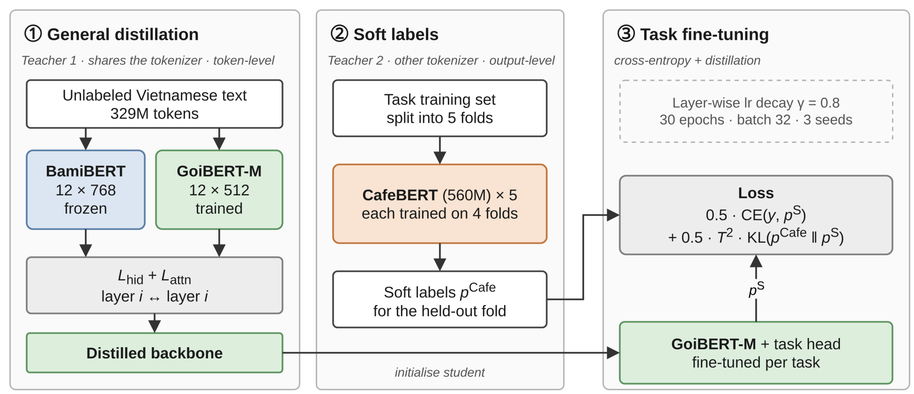

<div align="center">

# GoiBERT: Compact Vietnamese Language Models via Two-Stage Knowledge Distillation

**Quang Anh Kiet Tran**<sup>1</sup> · **Nam Anh Tran**<sup>2</sup> · **Manh Hung Trinh**<sup>3</sup> · **Thanh Danh Le**<sup>2</sup> · **Khang Nhat Hoang Vo**<sup>4</sup> · **Huynh Dai Nhan Tran**<sup>5</sup>

<sup>1</sup>UIT, VNU-HCM &nbsp; <sup>2</sup>IU, VNU-HCM &nbsp; <sup>3</sup>University of Eastern Finland &nbsp; <sup>4</sup>MBZUAI &nbsp; <sup>5</sup>University of Jyväskylä

Correspondence: [huynh.d.n.tran@jyu.fi](mailto:huynh.d.n.tran@jyu.fi)

[🤗 GoiBERT-base](https://huggingface.co/2HeartsVN/GoiBERT-S) · [🤗 GoiBERT-large](https://huggingface.co/2HeartsVN/GoiBERT-M) · [Corpus card](release/goi-corpus-v2/README.md)

</div>

---

## Overview

Vietnamese pre-trained encoders have improved rapidly, but the strongest ones are either large models with multilingual vocabularies or depend on an external word segmenter, which makes them costly to deploy. **GoiBERT** is a family of two compact Vietnamese encoders, with **26.4M** and **49.4M** parameters, that read **raw text with no word segmentation**.

GoiBERT learns from two teachers that complement each other, and each teacher is used in the stage where its strengths matter:

1. **General distillation.** [BamiBERT](https://huggingface.co/Qualcomm-AI-Research/BamiBERT) uses the same tokenizer as GoiBERT. It teaches general-purpose representations through layer-wise hidden-state and attention transfer on unlabeled text.
2. **Out-of-fold task distillation.** CafeBERT (559M) is much larger and uses a different tokenizer. It provides task-level soft labels at the output, where the tokenizer mismatch does not matter. These labels are produced *out of fold*, so no teacher ever labels an example it was trained on.

Across eight benchmarks covering text classification, aspect-based sentiment analysis (ABSA), natural language inference (NLI) and named entity recognition (NER):

- **GoiBERT-large** has the highest average score among non-teacher models. It has fewer than half of BamiBERT's parameters and twice its GPU throughput.
- **GoiBERT-base** reaches 99% of BamiBERT's average score with a quarter of its parameters and 3.5× its throughput.

<p align="center">
  
</p>
<p align="center"><em>The GoiBERT training pipeline. (1) The student matches the hidden states and attention maps of a frozen BamiBERT on unlabeled text. (2) Five CafeBERT teachers, each fine-tuned on four folds, label the held-out fold. (3) The distilled backbone is fine-tuned on gold labels and CafeBERT soft labels, with layer-wise learning-rate decay.</em></p>

## Models

| Model (paper name) | Hub ID | Layers | Hidden | Heads | FFN | Params | Embedding share |
|---|---|---:|---:|---:|---:|---:|---:|
| GoiBERT-base | [`2HeartsVN/GoiBERT-S`](https://huggingface.co/2HeartsVN/GoiBERT-S) | 10 | 384 | 6 | 1,536 | 26.4M | 33% |
| GoiBERT-large | [`2HeartsVN/GoiBERT-M`](https://huggingface.co/2HeartsVN/GoiBERT-M) | 12 | 512 | 8 | 2,048 | 49.4M | 23% |

Both models follow the RoBERTa encoder architecture. They use BamiBERT's 20,481-token tokenizer and 64-dimensional attention heads. The released checkpoints are the backbone encoders after general distillation (Stage 1) and have no task head. Distillation used sequences of at most 256 tokens, so we recommend `max_length=256`.

### Quick start

```python
from transformers import AutoTokenizer, AutoModel

tokenizer = AutoTokenizer.from_pretrained("2HeartsVN/GoiBERT-M")
model = AutoModel.from_pretrained("2HeartsVN/GoiBERT-M")

inputs = tokenizer("Sản phẩm dùng tốt, giao hàng nhanh.", return_tensors="pt",
                   truncation=True, max_length=256)
hidden = model(**inputs).last_hidden_state   # (1, seq_len, 512)
```

## Method

### Compact architecture and initialization

The small vocabulary is itself a source of efficiency. Embeddings make up only 33% (base) and 23% (large) of the parameters, compared with 46% for CafeBERT and 69% for XLM-R. GoiBERT-large's word embeddings are initialized by projecting BamiBERT's 768-dimensional embedding matrix onto its 512 leading principal components, then rescaling to the student's initialization scale. Transformer blocks are initialized randomly.

### Stage 1: general distillation

The student matches a frozen BamiBERT on unlabeled text. A trainable linear projection $P^v_\ell$ maps each student layer into the 768-dimensional teacher space, and the error is computed only over non-padding positions:

$$\mathcal{L}_{\text{hid}} = \frac{1}{L_v+1}\sum_{\ell=0}^{L_v} \text{MSE}_{\text{nonpad}}\big(P^v_\ell(H^v_\ell),\, H^B_{\pi_v(\ell)}\big)$$

The two models have different numbers of heads, so we match **head-averaged** post-softmax attention maps $\bar A^m_\ell = \frac{1}{a_m}\sum_h A^m_{\ell,h}$:

$$\mathcal{L}_{\text{att}} = \frac{1}{L_v}\sum_{\ell=1}^{L_v} \text{MSE}\big(\bar A^v_\ell,\, \bar A^B_{\pi_v(\ell)}\big), \qquad \mathcal{L}_{\text{GD}} = \mathcal{L}_{\text{hid}} + \mathcal{L}_{\text{att}}$$

**Layer mapping.** For GoiBERT-large, $\pi_{\text{large}}$ is the identity (12 ↔ 12 layers). For GoiBERT-base, $\pi_{\text{base}}(0)=0$ aligns the embedding outputs, and student layers 1–10 learn from teacher layers $(1, 2, 4, 5, 6, 7, 8, 10, 11, 12)$. Teacher layers 3 and 9 are skipped, and depth order is preserved.

### Stage 2: out-of-fold task distillation

A 559M-parameter teacher fits its own training examples closely, so its predictions on them are nearly one-hot. We therefore cross-fit in the spirit of stacked generalization. The training set is split into five folds, one CafeBERT is fine-tuned on each set of four folds, and it predicts only the held-out fold. The student is trained with

$$\mathcal{L}_{\text{task}} = \alpha\,\text{CE}\big(y, p_S^{(1)}\big) + (1-\alpha)\,T^2\,\text{KL}\big(p_C^{(T)} \,\|\, p_S^{(T)}\big), \qquad \alpha = 0.5,\; T = 2.$$

The loss is applied once per example for classification and NLI, and independently to each aspect slot for ABSA. For NER, both models' predictions are aligned to the first subword of each original syllable.

**Layer-wise learning-rate decay (LLRD).** Layer $\ell$ uses $\eta_\ell = \eta\,\gamma^{L_v-\ell}$ with $\gamma = 0.8$. The embeddings use $\eta\gamma^{L_v}$ and the task head uses $\eta$.

## Experimental Setup

### Benchmarks

We keep the official training, validation and test splits of every dataset.

| Task | Family | Domain | Metrics | Primary metric |
|---|---|---|---|---|
| UIT-VSFC Sentiment | Classification | Student feedback | Acc., M-F1 | M-F1 |
| UIT-VSFC Topic | Classification | Student feedback | Acc., M-F1 | M-F1 |
| ViSpamReviews (4-class) | Classification | E-commerce reviews | Acc., M-F1 | M-F1 |
| UIT-ViSFD | ABSA | Smartphone reviews | Det., Pair | Pair |
| UIT-ABSA Restaurant | ABSA | Restaurant reviews | Det., Pair | Pair |
| UIT-ABSA Hotel | ABSA | Hotel reviews | Det., Pair | Pair |
| ViNLI (`presencesw/vinli_4_label`) | NLI | News (open domain) | Acc., M-F1 | M-F1 |
| PhoNER_COVID19 | NER | COVID-19 news | Ent. F1 | Ent. F1 |

*M-F1: macro-F1. Det.: aspect-detection F1. Pair: aspect–sentiment pair micro-F1. Ent. F1: strict entity-level F1.* This gives 15 metrics in total. All locally trained models are averaged over three fine-tuning seeds (42, 43, 44).

### Baselines

We compare with PhoBERT-base-v2, ViSoBERT, BamiBERT, XLM-R-base, ViDeBERTa (appendix only) and CafeBERT, which is also our task teacher. BamiBERT is the main comparison: it is the most recent compact Vietnamese encoder and our Stage-1 teacher. We re-ran it under the same downstream protocol, with its learning rate tuned on validation data and plain cross-entropy fine-tuning.

### Distillation corpus

General distillation uses **328.6M tokens** of clean, unlabeled Vietnamese text ([corpus card](release/goi-corpus-v2/README.md)):

| Source | Tokens | Share |
|---|---:|---:|
| HPLT 3.0 Vietnamese web (filtered and deduplicated) | 232.9M | 71% |
| Vietnamese Wikipedia (articles ≥ 300 words) | 49.4M | 15% |
| User-generated and forum text (from HPLT) | 25.5M | 8% |
| Unlabeled **training-split** text of the 8 benchmarks | 20.9M | 6% |

**Decontamination.** Any passage that matches validation or test content, by exact match or by a shared 13-gram, was removed.

### Hyperparameters

| | General distillation | Task fine-tuning |
|---|---|---|
| Steps / epochs | 120,000 steps | 30 epochs |
| Batch | 32 × 256 tokens | 32 |
| Optimizer | AdamW, lr 1e-4, wd 0.01 | AdamW, wd 0.01 |
| Schedule | 1,000 warmup steps, linear decay | 10% warmup, LLRD γ = 0.8 |
| Learning rate | 1e-4 | 1e-5 (VSFC), 5e-5 (ViSpam), 1e-4 (others) |
| Precision / hardware | bf16, 1× NVIDIA L40S | — |
| Seeds | 42 | 42, 43, 44 |

The BamiBERT re-run selects its learning rate from {1e-5, 2e-5, 5e-5} on validation data. All learning rates and checkpoints are selected on validation data only.

**Efficiency protocol.** We measure the encoder alone. GPU throughput and peak VRAM are measured on an L40S (bf16, SDPA attention, batch 32, length 256). CPU latency is measured on a single 128-token input with eight threads in fp32. The same protocol is applied to every model.

## Results

### Main results

Test results (%), one primary metric per task, averaged over three seeds. **Bold** marks the best non-teacher model in each row.

| Task | Metric | CafeBERT<sup>⋄</sup> | XLM-R<sup>†</sup> | ViSoBERT | PhoBERT-v2 | BamiBERT | GoiBERT-base | GoiBERT-large |
|---|---|---:|---:|---:|---:|---:|---:|---:|
| ViNLI | M-F1 | 86.19 | 77.01 | 67.67 | 78.87 | **80.18** | 75.86 | 78.52 |
| ViSpam | M-F1 | 77.22 | 76.55 | 77.10 | 77.86 | 77.55 | 76.52 | **78.13** |
| PhoNER | Ent. F1 | 95.47 | 92.50 | 93.07 | **95.44**<sup>‡</sup> | 94.32 | 92.97 | 93.47 |
| ABSA-Rest. | Pair | 77.41 | 71.58 | 74.68 | 74.12 | 73.53 | 74.15 | **76.00** |
| ABSA-Hotel | Pair | 74.78 | 71.23 | 74.17 | 72.35 | 73.94 | 75.01 | **75.67** |
| VSFC-Topic | M-F1 | 79.81 | 79.56 | 80.00 | 79.68 | 78.88 | 80.17 | **80.42** |
| VSFC-Sent. | M-F1 | 82.91 | 82.20 | 80.69 | **83.34** | 82.36 | 81.50 | 82.03 |
| ViSFD | Pair | 85.98 | 65.81 | 83.77 | 84.05 | 84.41 | 83.94 | **84.78** |
| **Average (8)** | | 82.47 | 77.06 | 78.89 | 80.71 | 80.65 | 80.02 | **81.13** |
| Params (M) ↓ | | 558.9 | 277.5 | 97.0 | 134.4 | 102.4 | **26.4** | 49.4 |
| GFLOPs (128 tok.) ↓ | | 78.9 | 22.4 | 22.4 | 22.4 | 22.4 | **4.8** | 10.1 |

<sup>⋄</sup>Task teacher of GoiBERT, shown for reference. <sup>†</sup>Reported results. <sup>‡</sup>Uses word-segmented input.

### Comparison by task family

Primary scores averaged by task family. Δ<sub>L−C</sub> is the gap between GoiBERT-large and its 11× larger task teacher, CafeBERT.

| Family | BamiBERT | GoiBERT-large | CafeBERT | Δ<sub>L−C</sub> |
|---|---:|---:|---:|---:|
| Classification (3) | 79.60 | 80.19 | 79.98 | +0.21 |
| ABSA (3) | 77.29 | 78.82 | 79.39 | −0.57 |
| NER (1) | 94.32 | 93.47 | 95.47 | −2.00 |
| NLI (1) | 80.18 | 78.52 | 86.19 | −7.67 |

Compression is nearly lossless for classification and ABSA. GoiBERT-large slightly surpasses its 559M-parameter teacher on classification and stays within 0.6 points on ABSA. Without ViNLI, it averages 81.50 over the other seven tasks, 0.44 points below CafeBERT (81.94). Most of the remaining gap is in NLI and, to a lesser extent, NER.

### Inference efficiency

Encoder weights are in bf16. Throughput (sentences/s) and peak VRAM are measured on an L40S with batch 32 and length 256. CPU latency is for one 128-token input, eight threads, fp32.

| Model | Weights | Throughput | VRAM | CPU latency |
|---|---:|---:|---:|---:|
| BamiBERT | 206 MB | 2,397 | 801 MB | 31.0 ms |
| GoiBERT-large | 99 MB | 4,827 (2.0×) | 410 MB | 19.4 ms |
| GoiBERT-base | **53 MB** | **8,285 (3.5×)** | **248 MB** | **14.2 ms** |

### Ablation study

Cumulative ablation on the test set, mean of three seeds. ABSA-R is Restaurant pair F1; VSFC-T and ViNLI are macro-F1. Values in parentheses are the change from the previous row.

| Setting | ABSA-R | VSFC-T | ViNLI |
|---|---:|---:|---:|
| ***GoiBERT-large*** | | | |
| CE only (no GD) | 59.35 | 77.42 | 45.02 |
| + General KD | 72.89 (+13.5) | 78.06 (+0.6) | 76.18 (+31.2) |
| + Task KD (OOF) | 74.81 (+1.9) | 78.94 (+0.9) | 77.60 (+1.4) |
| + LLRD (full) | **76.00** (+1.2) | **80.42** (+1.5) | **78.52** (+0.9) |
| ***GoiBERT-base*** | | | |
| CE only (no GD) | 59.43 | 77.30 | 44.04 |
| + General KD | 71.12 (+11.7) | 79.29 (+2.0) | 71.10 (+27.1) |
| + Task KD (OOF) | 72.85 (+1.7) | 78.72 (−0.6) | 74.05 (+3.0) |
| + LLRD (full) | **74.15** (+1.3) | **80.17** (+1.5) | **75.86** (+1.8) |

General distillation is the backbone of the recipe. Out-of-fold CafeBERT supervision improves five of the six settings, and LLRD improves every task for both variants.

<details>
<summary><b>Complete results: all 15 metrics</b></summary>

<br>

**Bold** marks the best value in each row; for parameter counts and GFLOPs, lower is better. <sup>†</sup>Reported results. <sup>‡</sup>Requires word-segmented input. ∼ and ≥ mark approximate values and lower bounds.

| Task | Metric | CafeBERT | XLM-R<sup>†</sup> | ViDeBERTa<sup>†</sup> | ViSoBERT | PhoBERT-v2 | BamiBERT | GoiBERT-base | GoiBERT-large |
|---|---|---:|---:|---:|---:|---:|---:|---:|---:|
| ViNLI | Acc. | **86.08** | 76.83 | 61.08 | 67.55 | 78.75 | 80.07 | 75.75 | 78.39 |
| | M-F1 | **86.19** | 77.01 | 60.71 | 67.67 | 78.87 | 80.18 | 75.86 | 78.52 |
| ViSpam | Acc. | 90.50 | 90.16 | 86.21 | 90.78 | **90.82** | 90.19 | 89.88 | 90.75 |
| | M-F1 | 77.22 | 76.55 | 67.04 | 77.10 | 77.86 | 77.55 | 76.52 | **78.13** |
| PhoNER | Ent. F1 | **95.47** | 92.50 | 94.50<sup>‡</sup> | 93.07 | 95.44<sup>‡</sup> | 94.32 | 92.97 | 93.47 |
| ABSA-Rest. | Det. | **88.83** | 82.18 | 73.56 | 87.06 | 87.32 | 87.03 | 86.91 | 88.14 |
| | Pair | **77.41** | 71.58 | 63.78 | 74.68 | 74.12 | 73.53 | 74.15 | 76.00 |
| ABSA-Hotel | Det. | 80.37 | 77.70 | 72.05 | 79.94 | 78.94 | 80.15 | 80.66 | **80.96** |
| | Pair | 74.78 | 71.23 | 62.97 | 74.17 | 72.35 | 73.94 | 75.01 | **75.67** |
| VSFC-Topic | Acc. | 88.88 | 89.18 | 83.94 | 88.85 | 88.89 | 88.82 | 89.36 | **89.73** |
| | M-F1 | 79.81 | 79.56 | 66.49 | 80.00 | 79.68 | 78.88 | 80.17 | **80.42** |
| VSFC-Sent. | Acc. | **93.79** | 93.56 | 87.86 | 92.57 | 93.63 | 93.50 | 92.70 | 93.56 |
| | M-F1 | 82.91 | 82.20 | 70.74 | 80.69 | **83.34** | 82.36 | 81.50 | 82.03 |
| ViSFD | Det. | **90.05** | 82.73 | 75.53 | 88.93 | 89.32 | 89.26 | 89.30 | 89.81 |
| | Pair | **85.98** | 65.81 | 64.20 | 83.77 | 84.05 | 84.41 | 83.94 | 84.78 |
| **Average (15)** | | **85.22** | 80.59 | 72.71 | 81.79 | 83.56 | 83.61 | 82.98 | 84.02 |
| Params (M) | | 558.9 | 277.5 | ∼183.4 | 97.0 | 134.4 | 102.4 | **26.4** | 49.4 |
| &nbsp;&nbsp;embeddings | | 256.5 | 192.4 | ∼98.3 | 11.9 | 49.4 | 17.3 | **8.7** | 11.5 |
| &nbsp;&nbsp;encoder | | 302.3 | 85.1 | ∼85.1 | 85.1 | 85.1 | 85.1 | **17.7** | 37.8 |
| GFLOPs (128 tok.) | | 78.9 | 22.4 | ≥22.4 | 22.4 | 22.4 | 22.4 | **4.8** | 10.1 |
| GFLOPs (512 tok.) | | 335.0 | 96.6 | ≥96.6 | 96.6 | 96.6 | 96.6 | **22.1** | 45.1 |

The 15-metric average is only a descriptive summary: the metrics mean different things, and tasks with two metrics weigh more than PhoNER.

</details>

<details>
<summary><b>Seed-wise variation: BamiBERT vs. GoiBERT-large</b></summary>

<br>

Values are means, with [min, max] across seeds 42, 43 and 44. The ranges describe fine-tuning variability only. They are not confidence intervals, and general distillation was not repeated.

| Task | Metric | BamiBERT | GoiBERT-large |
|---|---|---|---|
| ViNLI | Acc. | 80.07 [79.94, 80.24] | 78.39 [78.33, 78.47] |
| | M-F1 | 80.18 [80.04, 80.33] | 78.52 [78.46, 78.57] |
| ViSpam | Acc. | 90.19 [89.98, 90.41] | 90.75 [90.44, 91.07] |
| | M-F1 | 77.55 [75.58, 78.62] | 78.13 [77.78, 78.32] |
| PhoNER | Ent. F1 | 94.32 [94.24, 94.39] | 93.47 [93.44, 93.48] |
| ABSA-Rest. | Det. | 87.03 [86.45, 87.52] | 88.14 [87.90, 88.39] |
| | Pair | 73.53 [72.36, 74.15] | 76.00 [75.72, 76.52] |
| ABSA-Hotel | Det. | 80.15 [80.12, 80.19] | 80.96 [80.72, 81.23] |
| | Pair | 73.94 [73.82, 74.06] | 75.67 [75.27, 75.99] |
| VSFC-Topic | Acc. | 88.82 [88.50, 89.36] | 89.73 [89.45, 89.96] |
| | M-F1 | 78.88 [78.18, 79.80] | 80.42 [79.88, 81.03] |
| VSFC-Sent. | Acc. | 93.50 [93.24, 93.75] | 93.56 [93.40, 93.71] |
| | M-F1 | 82.36 [81.61, 83.03] | 82.03 [80.77, 83.36] |
| ViSFD | Det. | 89.26 [89.03, 89.39] | 89.81 [89.64, 89.90] |
| | Pair | 84.41 [84.11, 84.64] | 84.78 [84.66, 85.03] |

</details>

## Which variant should I use?

- **GoiBERT-large** is the better default when accuracy matters and a GPU is available. It is the strongest non-teacher model on average and roughly matches CafeBERT on classification and ABSA, at half of BamiBERT's serving cost.
- **GoiBERT-base** suits CPU-only inference, edge devices or high-throughput batch labeling. It has the lowest latency and memory, and its average score is only 1.1 points below GoiBERT-large.
- For NLI-heavy applications, a larger encoder is still preferable.

## Limitations

- **Not a pure architecture comparison.** GoiBERT also benefits from CafeBERT distillation, LLRD and a distillation corpus that includes benchmark *training* text. The BamiBERT re-run uses plain cross-entropy fine-tuning.
- **Test feedback.** We decided to build the larger variant after seeing earlier test results, so test feedback partly shaped model development.
- **Statistics.** General distillation was run once. Seed ranges reflect fine-tuning variability only and are not significance tests. The ablations cover three tasks and add components one at a time.
- **Scope.** We distill on sequences of at most 256 tokens, and no benchmark probes unseen domains or dialectal variation. The efficiency numbers leave out tokenization, task heads and the one-time cost of training five out-of-fold CafeBERT teachers per task.
- **Bias.** The models are trained on public web text and benchmarks and may inherit social biases from these sources and from their teachers. We have not audited them for bias.

## Citation

If you use GoiBERT, please cite:

```bibtex
@misc{tran2026goibert,
  title  = {{GoiBERT}: Compact Vietnamese Language Models via Two-Stage Knowledge Distillation},
  author = {Tran, Quang Anh Kiet and Tran, Nam Anh and Trinh, Manh Hung and
            Le, Thanh Danh and Vo, Khang Nhat Hoang and Tran, Huynh Dai Nhan},
  year   = {2026}
}
```

## Acknowledgements

GoiBERT builds on [BamiBERT](https://huggingface.co/Qualcomm-AI-Research/BamiBERT), whose tokenizer and representations it inherits, and on CafeBERT, which supplies task supervision. We thank the authors of the UIT-VSFC, ViSpamReviews, UIT-ViSFD, UIT-ABSA, ViNLI and PhoNER_COVID19 datasets, and the HPLT project for its Vietnamese web data.
