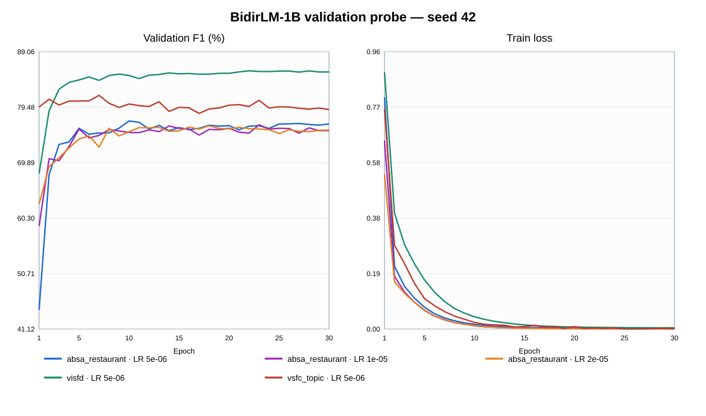

# BidirLM-1B-Base: BPB tiếng Việt và probe fine-tune

**Trạng thái:** hoàn tất hai pha ngày 2026-09-23. Gate pha 1 **PROCEED**; gate pha 2 **CLOSE**. Lần chạy đầu bị sandbox chặn GPU.

## 1. Môi trường, model và nguồn

Chạy tại `/home/kiettqa/GoiBERT`, `PYTHONPATH=src`, `.venv-qwen-probe`: Python `3.12.3`, PyTorch `2.6.0+cu124`, Transformers `4.57.6`, tokenizers `0.22.2`, NumPy `2.5.3`, huggingface_hub `0.36.2`, SentencePiece `0.2.1` (cài riêng vào venv vì thiếu), GPU NVIDIA L40S. Chỉ GPU 1 được dùng đến hết preflight; mỗi thời điểm một job. Không dùng GPU 3; không đụng process của người khác. Việc tải model bật `HF_HUB_OFFLINE=0` tường minh, pin commit, sau đó mọi lần nạp dùng snapshot local với `HF_HUB_OFFLINE=1`.

| Vai trò | Repo và commit | SHA-256 weights | SHA-256 tokenizer.model |
|---|---|---|---|
| Decoder Qwen pha 1 | `Qwen/Qwen3-0.6B-Base` `da87bfb608c14b7cf20ba1ce41287e8de496c0cd` (local sẵn) | `cd2a512003e2f9f3cd3c32a9c3573f820bb28c940f73c57b1ddaa983d9223eba` | BPE, không có file này |
| Decoder Gemma pha 1 | `unsloth/gemma-3-1b-pt` `34a98bf3eaecc08c699516f625eb5e56e4c5d99d` | **`ee5250f6eb1aa7cfb729dfd4dc8d9964fd772324776c6d00bf2bc674c069cb27`** | **`1299c11d7cf632ef3b4e11937501358ada021bbdf7c47638d13c0ee982f2e79c`** |
| BidirLM-1B pha 2 | `BidirLM/BidirLM-1B-Base`, nhánh `transformers-v4`, `f98e971f0f0bfcf88a7a8e0b74914497930f51f3` | `d0e6be7183b604eff83ce294b00f05108ff7ad33c904dc6624e5f6f65ddc78ec` | `1299c11d7cf632ef3b4e11937501358ada021bbdf7c47638d13c0ee982f2e79c` |

Hai SHA-256 bắt buộc của Gemma mirror **khớp đúng** giá trị trong protocol. Danh sách SHA-256 **mọi file** của mỗi snapshot nằm trong `phase1/manifest.json` và `phase2/preflight.json`. Qwen và BidirLM card ghi Apache-2.0; Gemma nền và tokenizer thuộc Gemma Terms of Use, dù card BidirLM-1B ghi Apache-2.0 cho model phát hành.

## 2. Pha 1 — dữ liệu và check

Domain A dùng general pool v3 CC0, thứ tự `parts` rồi `pool_index` giống `prepare_data.py`; đọc text qua `common_v2.part_texts`, không dùng validation/test. Có **1.226.854** doc với text, đúng data manifest. Stream `tokens.npy` có **1.226.853 EOS**: doc cuối dài, chỉ còn **1.204 token sau EOS cuối** trong stream; **325 token bị cắt** khi ép thành chuỗi 512. Tokenize lại doc cuối xác nhận phần đuôi còn lại khớp chính xác và EOS của doc đó thuộc phần bị cắt; doc này bị loại khỏi tập đủ điều kiện. Đây là ngoại lệ cắt đuôi mà protocol đã dự liệu, không phải tài liệu train được chọn nhầm.

SHA-256 của `tokens.npy` = `08be4eead09e204bb910912acba6e58d7a24933b850f9b62c03d48e0b1121174` và `order.npy` = `3d4283a5f2bdc37eb2e164b9ba623287cec163234c97df86cd59a535af384e26`; cả hai khớp manifest nguồn.

`order[:488281]` xác định chuỗi P_vi đã train. Chỉ doc mà **mọi** chuỗi chứa token đều ngoài tập ấy mới đủ điều kiện: **659.346 doc**. Lấy 2.000 doc bằng `numpy.random.default_rng(42)`. Cả **20/20** doc kiểm tokenize lại bằng tokenizer BidirLM-0.6B pinned đều khớp chính xác lát token trong `tokens.npy`. `sample_manifest.json` chứa `pool_index`, `kh64` và SHA-256 danh sách text sau cắt: `a3ed131dd041110d93cf34f5dbf7c49e280f7dd2523156b6ad853e379240933b`. Text A được cắt tại khoảng trắng cuối trước 2.000 ký tự; **100%** text sau cắt đã NFC.

Lần chạy script pha 1 đầu tự dừng vì check phần sau EOS cuối phải ngắn hơn 512 token quá chặt; doc cuối đã bắt đầu từ chuỗi trước và còn 1.204 token trong stream. Check được sửa thành so khớp chính xác phần đuôi tokenize lại và đúng 325 token bị cắt; phương pháp chọn mẫu và BPB giữ nguyên. Hai log của lần dừng và lần chạy thành công được giữ riêng.

Domain B chỉ lấy `split_field(bundle, "train")` của 5 task qua `load_task_bundle(..., include_test=False)`, không lấy nhãn. **44.846** hàng gốc thành **33.414** chuỗi duy nhất khi bỏ trùng chính xác; tỷ lệ NFC **0,9928173819357156**. Sentiment và Topic chia sẻ nhiều text nên bước bỏ trùng là cần thiết. Không normalize thêm hoặc thêm EOS.

## 3. Pha 1 — BPB và gate

Mỗi text được đo độc lập theo `[start] + tokens(text)`; Qwen dùng `<|endoftext|>` id 151643, Gemma dùng `<bos>` id 2. Text tokenized với `add_special_tokens=False`; mọi token text đều được tính NLL, start không tính. Gemma dùng **slow `GemmaTokenizer` từ `tokenizer.model`**, nên không cần điều kiện tương đương fast/slow. Hai decoder chạy weights fp32, `eval()`, TF32 tắt, cùng chuỗi và cùng số byte UTF-8. Mỗi model × domain có 5/5 text kiểm tổng NLL tự tính khớp `outputs.loss`; sai số tương đối lớn nhất **5,23482587566952e-8**, dưới ngưỡng `1e-4`. BPB là tổng NLL chia `ln(2)` và tổng byte; bootstrap theo text 1.000 lần, seed 42. Gemma3 giữ nguyên sliding window 512 ở 5/6 lớp; không sửa kiến trúc.

| Domain | Model | BPB | Tokens/byte | Tokens/word | Token dài nhất |
|---|---|---:|---:|---:|---:|
| A — 2.000 doc, 4.285.124 byte | Qwen3-0.6B-Base | 0,7878126271465467 | 0,2198643493163792 | 1,3141981146550834 | 745 |
| A | Gemma3-1B-pt | 0,6323487313046507 | 0,209009587587197 | 1,2493158022480186 | 728 |
| B — 33.414 text, 3.896.222 byte | Qwen3-0.6B-Base | 1,584052115959005 | 0,23506668767847416 | 1,32188692534625 | 264 |
| B | Gemma3-1B-pt | 1,3377511909445052 | 0,22277170038052246 | 1,2527466183254143 | 267 |

Phân vị BPB theo **text** (khác với BPB gộp theo byte ở bảng trên):

| Domain | Model | p5 | p50 | p95 |
|---|---|---:|---:|---:|
| A | Qwen | 0,5684204856903148 | 0,7946268591742064 | 1,038986620603158 |
| A | Gemma | 0,4478439914467666 | 0,6340572830215934 | 0,8437215139413548 |
| B | Qwen | 1,0314886394373344 | 1,6404227725148544 | 2,7055542253920986 |
| B | Gemma | 0,8696216935258712 | 1,3873215045078084 | 2,4290907945960556 |

| Domain | `r = BPB_Gemma / BPB_Qwen − 1` | CI bootstrap 95% |
|---|---:|---:|
| A (gate chính) | **−0,19733613106073877** | [−0,19962267570722925; −0,19512238831285966] |
| B (gate phụ) | **−0,15548789243299999** | [−0,15647155324997764; −0,15444305045849663] |

**Gate pha 1 = PROCEED** vì cả `r_A` và `r_B` ≤ `+0,05`; quyết định được ghi trong `phase1/gate.json` trước bước pha 2. Phân vị BPB theo doc (0/5/25/50/75/95/100%) và NLL/tokens/byte từng text nằm trong `bpb_results.json` và `per_text_bpb.jsonl`.

Kiểm lại độc lập bằng cách đọc toàn bộ 35.414 dòng `per_text_bpb.jsonl`: số dòng, tổng byte, BPB gộp và `r` đều khớp `bpb_results.json` (sai khác BPB đo được **0,0**); 2.000 hash text A và 33.414 hash text B đều duy nhất trong từng domain.

Pha 1 dùng GPU 1; Qwen **280,0022213459015 s**, peak allocated **5.215.172.608 byte**, phần inference **6.863,642314892285 token/s**; Gemma **302,0083167552948 s**, peak **8.887.013.888 byte**, phần inference **6.088,863856139197 token/s**. Wall từ lúc bắt đầu script tới gate **0,2589590224954817 GPU-giờ** theo cách tính bảo thủ gồm cả chuẩn bị dữ liệu CPU và bootstrap.

## 4. Pha 2 — khác biệt custom code và preflight

Đã đọc `modeling_bidirlm.py` ở commit 1B trước khi nạp. Bản 0,6B dựa trên Qwen3, tự prepend id **151644**, attention đầy đủ và một RoPE; bản 1B dựa trên Gemma3, tự prepend **BOS id 2**, 26 lớp gồm **22 sliding + 4 full**, dùng RoPE local riêng cho sliding và RoPE global cho full. Các lớp sliding dùng cửa sổ hai chiều đối xứng ±256 token (config `sliding_window=512`, `effective_sliding_window=256`); cả hai bản pack token thật theo `cu_seqlens` khi có `attention_mask`, rồi trả `last_hidden_state[:, :-1]` sau khi dựng lại batch. Do đó pooling dùng mask gốc, như arm O. `attention_dropout` ở 1B là thuộc tính của `Gemma3Attention`; đã gán config và cả 26 module.

Suy ra từ cửa sổ và max length của recipe: input task dài tối đa 256 token, model prepend một BOS thành tối đa 257 vị trí; khoảng cách lớn nhất 256 nên cửa sổ ±256 bao phủ toàn câu trong các run fine-tune. Pha 1 đo decoder gốc trên doc dài hơn, vì vậy sliding window 512 vẫn có tác dụng ở phép BPB.

Class custom 1B không khai báo hỗ trợ tên `attn_implementation="sdpa"` với Transformers 4.57.6, nên nạp bằng tên `"eager"` được class chấp nhận. Nhánh thực thi trong code 1B vẫn là hàm attention riêng `sdpa_attention_forward` với mask packed hai chiều; preflight kiểm chức năng trực tiếp.

| Check preflight | Kết quả |
|---|---|
| Load pinned weights | missing/unexpected/mismatched = **0/0/0** |
| Số tham số encoder | **999.885.952 tổng**, **697.896.064 ngoài embedding**; với E14 head **1.001.269.552** |
| Hai chiều trên batch có padding | đổi token cuối → hidden đầu Δmax **5,601597785949707**; đổi token đầu → hidden cuối Δmax **10,665313720703125** |
| Bất biến padding fp32 | đổi id trong ô pad → hidden token thật Δmax **0,0** |
| Attention dropout | **26 module** ở 0,1; hai forward train Δmax **17,71588897705078**, eval Δmax **0,0** |
| Tokenizer | `GemmaTokenizerFast` 262.146 id; BOS 2, EOS 1, PAD 0; `add_special_tokens=True` không thêm BOS/EOS; model tự prepend BOS |
| Tỷ lệ train >256 token | Restaurant **0,0**; ViSFD **0,00012843565373747752**; Topic **0,0** |
| Head hash ban đầu | `3223af0a7ed69a5be2b23ba83d7b187a0ff8916c5556fa7bd9a9c445eab0be67` |
| Sức chứa | micro 32 OOM khi thử batch 256 token; micro **16** đạt peak **31.196.530.176 byte** dưới 40 GB, dùng accumulation 2 để giữ effective batch 32 |
| Smoke Restaurant đủ 1 epoch | loss **0,3160147245593823** hữu hạn; val F1 **0,6610169491525424**; reload, file predictions, dự đoán và ID đều khớp |

**Preflight PASS**, `phase2/preflight.json`; thời gian **188,4356496334076 s**. OOM của micro 32 là kết quả kiểm sức chứa, không phải OOM của run được chọn. Tokenizer pinned phát cảnh báo regex từ Transformers; đường fine-tune giữ nguyên tokenizer phát hành và preflight đã kiểm hành vi BOS/EOS.

Kiểm bổ sung chỉ đọc: tokenizer có `<image_soft_token>` id 262144 và `<|mask|>` id 262145, lớn hơn `vocab_size=262144`; tokenize toàn bộ train và validation của Restaurant, ViSFD, Topic cho **0 hàng** chứa ID ngoài vocab ở cả sáu split. Không dùng test.

## 5. Fine-tune và gate pha 2

Đã chạy đúng năm run seed 42: Restaurant LR `{5e-6,1e-5,2e-5}`, rồi ViSFD/Topic tại LR Restaurant tốt nhất; validation-only. Recipe như arm O: custom BidirLM attention hai chiều native, mean pooling trên `last_hidden_state` với mask gốc, `pooled.unsqueeze(1)` vào E14 `ClassificationHead`, CE, 30 epoch, max length 256, effective batch 32 = micro 16 × accumulation 2, bf16 autocast với weights master fp32. AdamW `weight_decay=0,01`, betas `(0,9,0,999)`, eps `1e-8`; warmup tuyến tính 10%, clip norm 1,0; best epoch theo validation F1.

| Task | LR | Best val F1 | Best epoch | Phút | Peak allocated byte | Postrun |
|---|---:|---:|---:|---:|---:|---|
| Restaurant | 5e-6 | 0,7708634828750603 | 10 | 65,09175846179326 | 20.248.265.216 | PASS |
| Restaurant | 1e-5 | 0,7641734159123392 | 23 | 70,80998018582662 | 20.248.265.216 | PASS |
| Restaurant | 2e-5 | 0,7626384207992296 | 18 | 62,39185537894567 | 20.248.265.216 | PASS |
| ViSFD | 5e-6 | 0,8575703171753442 | 22 | 74,58164753516515 | 23.193.440.256 | PASS |
| Topic | 5e-6 | 0,8151567693516449 | 7 | 104,81463072299957 | 20.243.039.744 | PASS |

Mỗi run Restaurant có 7.028 train/771 validation rows, 6.600 optimizer step. Throughput tính trên thời gian các epoch (gồm validation): LR 5e-6 **54,520737206816506 ví dụ train/giây**, **1,7066821550227136 step/giây**; LR 1e-5 **50,16195328961111 ví dụ/giây**, **1,5702375816326757 step/giây**; LR 2e-5 **57,165960640848475 ví dụ/giây**, **1,7894865311591723 step/giây**. Reload checkpoint cho đúng best F1, file predictions tính lại đúng giá trị đó, dự đoán sau reload giống hệt, ID đủ và ổn định ở cả ba run. Head init SHA-256 và mọi siêu tham số ngoài LR đều trùng trong ba `resolved_config.json`.

**LR Restaurant được chọn = 5e-6** theo F1 chưa làm tròn; best `0,7708634828750603` thấp hơn ngưỡng Restaurant `0,772` đúng **0,0011365171249396733 F1**, và thấp hơn CafeBERT **0,006333666768645108 F1**. Sau run đầu, ước tính bảo thủ toàn pha 2 là **8,13861422033234 GPU-giờ** < 12; sau ba Restaurant đã dùng **3,3572364697853727 GPU-giờ** kể cả preflight, nên tiếp tục ViSFD và Topic ở LR đã chọn.

ViSFD có 7.786 train/1.112 validation rows, 7.320 optimizer step; throughput gồm validation là **52,92331661007525 ví dụ train/giây**, **1,6585267470920062 step/giây**. Best sau reload và file predictions đều là `0,8575703171753442`, dự đoán/ID khớp. ViSFD **cao hơn CafeBERT 0,002905245405009249 F1** (**0,2905245405009249 điểm phần trăm**) theo số gốc. Sau bốn run, ngân sách bảo thủ đã dùng **4,600263928704792 GPU-giờ**; kiểm trước Topic là GO.

Topic có 11.426 train/1.583 validation rows, 10.740 optimizer step; throughput gồm validation là **54,715030134887726 ví dụ train/giây**, **1,7143340441352883 step/giây**. Best sau reload và file predictions đều là `0,8151567693516449`, dự đoán/ID khớp. Best ở epoch 7; F1 các epoch cuối thấp hơn dù train loss rất nhỏ. Topic vượt ngưỡng riêng `0,812` đúng **0,0031567693516448836 F1**, nhưng thấp hơn CafeBERT **0,0022890671576026866 F1**.

Các số tham chiếu F1 validation lấy trực tiếp từ `artifacts/base_encoder_baseline/summary.json` và `artifacts/bidirlm_vi_mntp/summary.json`, chưa làm tròn trước khi so:

| Task | O | P_vi | BamiBERT | mmBERT | CafeBERT | **B1B** | B1B − Cafe |
|---|---:|---:|---:|---:|---:|---:|---:|
| Restaurant | 0,7571976967370442 | 0,7614900822447992 | 0,7474178403755869 | 0,75626204238921 | 0,7771971496437055 | **0,7708634828750603** | −0,006333666768645108 |
| ViSFD | 0,8485393258426966 | 0,8543689320388349 | 0,8438339802926247 | 0,836390977443609 | 0,8546650717703349 | **0,8575703171753442** | +0,002905245405009249 |
| Topic | 0,8073548845647585 | 0,8069444272956812 | 0,7953280821882547 | 0,811808487044734 | 0,8174458365092476 | **0,8151567693516449** | −0,0022890671576026866 |

B1B cao hơn O và P_vi ở cả ba task; các delta F1 B1B − P_vi là **+0,009373400630261153 Restaurant / +0,0032013851365092494 ViSFD / +0,008212342055963773 Topic**. Đường cong 30 epoch của cả năm run (validation F1 và train loss) ở [curves.svg](../artifacts/bidirlm_1b_probe/phase2/curves.svg); dữ liệu số trong `phase2/summary.json` và từng `epoch_curves.json`.



GPU-giờ pha 2: **6,294831204745504** cho năm run FT; preflight **0,052343236009279884**; tổng pha 2 theo cách tính bảo thủ **6,3471744407547845**, dưới trần 12. Cộng pha 1 **0,2589590224954817** thành **6,606133463250266 GPU-giờ**. Cách tính cộng wall time của mỗi run và toàn preflight nên có thể cao hơn thời gian GPU thực bận. Cả năm run có 30 epoch, `status=completed`, postrun checks PASS; biểu đồ SVG đã parse hợp lệ.

**Run Topic bị dừng, do root bổ sung.** Theo yêu cầu người dùng, root đã chạy thử Topic (lr 5e-6, seed 42) song song trên GPU 2. Run bắt đầu lúc 07:10:24Z và bị dừng khoảng 07:30Z ở epoch 5/30 để trả GPU 2 cho việc khác. Toàn bộ file dang dở và log được chuyển sang `phase2/aborted/vsfc_topic_lr5e-06_seed42_root_gpu2_stopped_20260923T0730Z/`. Run này **không** được dùng để chọn hay báo cáo F1; Topic ở trên lấy từ run hoàn chỉnh do `run_ft.sh` chạy lại từ đầu. Run dừng tiêu thêm khoảng **0,32 GPU-giờ**, nên tổng GPU thực của probe khoảng **6,93 GPU-giờ**, vẫn dưới trần 12. Ghi chú bàn giao: `phase2/logs/ROOT_NOTE_topic_launched_on_gpu2.md`.

**Gate pha 2 = CLOSE** theo điều kiện cố định: Restaurant `0,7708634828750603 < 0,772`, dù Topic `0,8151567693516449 ≥ 0,812`. Kết quả ViSFD cao hơn Cafe không đổi gate. Không chạy thêm seed, LR, task hoặc test.

## 6. Giới hạn và tái lập

BPB đo **decoder gốc**, không đo BidirLM đã adapt bằng MNTP. Cả hai decoder có thể đã thấy trang web tương tự trong pretrain dù doc A chưa thuộc train P_vi. Fine-tune chỉ một seed và chỉ validation; không mở test. Chênh lệch nhỏ ở F1 có thể chịu nhiễu seed. Domain A dùng pool general v3 CC0 đã lọc benchmark; domain B dùng text train task, không dùng nhãn cho BPB.

```bash
cd /home/kiettqa/GoiBERT
uv pip install --python .venv-qwen-probe/bin/python sentencepiece==0.2.1
HF_HUB_OFFLINE=0 .venv-qwen-probe/bin/python -c 'from huggingface_hub import snapshot_download; snapshot_download("unsloth/gemma-3-1b-pt", revision="34a98bf3eaecc08c699516f625eb5e56e4c5d99d")'
CUDA_VISIBLE_DEVICES=1 PYTHONPATH=src HF_HUB_OFFLINE=1 .venv-qwen-probe/bin/python scripts/bidirlm_1b_probe/bpb_measure.py
HF_HUB_OFFLINE=0 .venv-qwen-probe/bin/python -c 'from huggingface_hub import snapshot_download; snapshot_download("BidirLM/BidirLM-1B-Base", revision="f98e971f0f0bfcf88a7a8e0b74914497930f51f3")'
CUDA_VISIBLE_DEVICES=1 PYTHONPATH=src HF_HUB_OFFLINE=1 .venv-qwen-probe/bin/python scripts/bidirlm_1b_probe/preflight.py
PYTHONPATH=src HF_HUB_OFFLINE=1 bash scripts/bidirlm_1b_probe/run_ft.sh
```

Các lệnh trên sẽ từ chối ghi đè checkpoint FT đã có; tái lập cần dùng thư mục artifact mới hoặc bản sao riêng. Model Gemma và BidirLM-1B phải được tải trước vào HF cache ở đúng commit; lần chạy thực tế đã làm bước này với `HF_HUB_OFFLINE=0` và kiểm SHA-256.

## 7. Sai lệch và bất thường đã ghi nhận

- SentencePiece thiếu trong `.venv-qwen-probe`; đã dùng `uv pip` cài đúng `sentencepiece==0.2.1` vào venv theo mục môi trường của spec gốc. Đây là một lần ghi vào venv ngoài danh sách đường output của yêu cầu tiếp tục; không cài gói hệ thống hoặc đổi Transformers.
- `attn_implementation="sdpa"` bị Transformers từ chối cho class custom 1B. Dùng tên `"eager"` để nạp; code custom vẫn thực thi hàm attention packed hai chiều riêng, đã kiểm hướng đọc và padding.
- Một EOS của doc cuối nằm ngoài `tokens.npy` do cắt 325 token; đã xác nhận phần đuôi bằng tokenize lại và loại doc đó. Check đầu quá chặt đã được sửa; log lần dừng được giữ.
- Micro 32 OOM trong phép thử sức chứa ở 256 token; micro 16 đạt, giữ effective batch 32 bằng accumulation 2. Đây là kết quả chọn micro, không phải run chính bị OOM.
- Tokenizer BidirLM pinned phát cảnh báo regex của Transformers. Giữ nguyên tokenizer phát hành, không đổi quy tắc tokenize giữa các run.

## 8. File tạo mới

- Source: `scripts/bidirlm_1b_probe/{bpb_measure.py,common.py,preflight.py,finetune.py,run_ft.sh,summarize.py}`.
- Pha 1: `artifacts/bidirlm_1b_probe/phase1/{manifest.json,sample_manifest.json,bpb_results.json,per_text_bpb.jsonl,gate.json}` và `logs/` (log tải Gemma, lần check EOS đầu dừng, lần BPB hoàn tất).
- Pha 2: `artifacts/bidirlm_1b_probe/phase2/{preflight.json,budget_estimate.json,summary.json,curves.svg}`, `logs/`, `preflight_smoke/`, và 5 thư mục `ft/B1B/<task>/lr_<lr>/seed_42/` chứa config, đường cong, metrics, predictions, checkpoint, metadata và status.
- Báo cáo: `docs/BIDIRLM_1B_PROBE_RESULT.md`.
