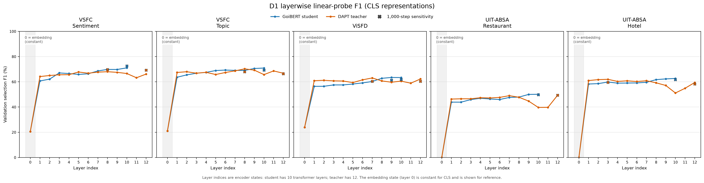
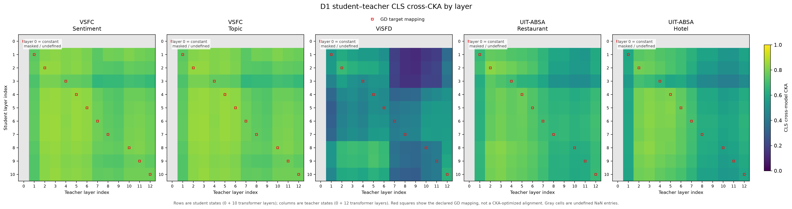

# D1 — kết quả chẩn đoán layer teacher/student

## Kết luận nghiên cứu

Đã hoàn tất vòng chẩn đoán: chưa có bằng chứng đủ mạnh để chỉ định một layer/FFN/attention block là bottleneck cần sửa. Không triển khai kiến trúc hoặc loss mới từ heatmap này.

Giả thuyết ban đầu rằng student có thể đã mất thông tin task rõ rệt tại một vùng layer trong GD chưa được hỗ trợ bởi các phép đo hiện tại. Điều này không chứng minh GD hoàn hảo hoặc teacher kém hơn: các phép đo chỉ đọc CLS bằng linear probes với mẫu train nhỏ.

## Đã chạy gì

- Hai backbone trước task fine-tune: student GD 10 layers/384 dim và teacher DAPT12 layers/768 dim. Teacher là derivative BamiBERT, không phải checkpoint BamiBERT gốc trong paper.
- Mỗi task 2.000 train rows cố định, full validation; đủ5 tasks. Không test hoặc cập nhật encoder. Cache10 model-task hoàn tất, khoảng 1.7 GB, cùng tokenizer/IDs/inputhashes.
- Probe CLS toàn bộ layer (gồm embedding), fixed200 AdamW steps và majority/labelshuffle controls. Vì loss còn giảm, root duyệt kiểm tra sensitivity1.000 steps cho final và best nonzero layer đã chọn ở200 steps, tối đa20 heads; không quét epoch/LR bằng validation.
- CKA trên1.024 train rows: CLS view chính, contentmean phụ; teacher-only row permutation làm reference. Hình final dùng Matplotlib.

## Kết quả probes

Bảng dưới dùng **layer cuối**, probe1.000 steps và encoder đóng băng. Đây không phải điểm fine-tune E1/E2 hoặc test benchmark; không so trực tiếp số tuyệt đối với các bảng đó.

| Task | Student GD | Teacher DAPT | Student − teacher |
|---|---:|---:|---:|
| vsfc_sentiment | 72.58 | 69.27 | +3.31 |
| vsfc_topic | 69.29 | 66.32 | +2.98 |
| visfd | 61.79 | 60.39 | +1.39 |
| absa_restaurant | 49.68 | 49.44 | +0.25 |
| absa_hotel | 61.74 | 58.20 | +3.54 |

Ở lượt200 steps, student tốt nhất ở layer 10 trên 4 task và layer 9 trên ViSFD. Kiểm tra1.000 steps đảo thứ hạng layer 9/10 ởViSFD. Teacher có best layer khác nhau theo task. Không có một điểm rơi chung mà các phép đo cùng xác nhận.

Loss train tiếp tục giảm khi tăng budget nhưng validation thường giảm ởTopic/ABSA. Đây là dấu hiệu kết quả probe phụ thuộc tối ưu và tổng quát hóa, không thể diễn giải đơn giản là lượng kiến thức trong layer. Bảng1.000 steps chỉ là sensitivity ở các layer đã chọn; không phải full layer sweep tại1.000 steps hoặc lời khẳng định mọi probe đã đạt optimum.

## Kết quả CKA

Mean trên các cặp GD được khai báo (bỏ embedding CLS undefined):

| Nhóm văn bản/task | Matched CKA | Teacher-row-permuted |
|---|---:|---:|
| VSFC Sentiment/Topic | 0.7911 | 0.0067 |
| ViSFD | 0.4971 | 0.0108 |
| Restaurant | 0.6941 | 0.0076 |
| Hotel | 0.6631 | 0.0084 |

Hai task VSFC có cùng văn bản và sample, nên CKA giống nhau là đúng và không phải hai bằng chứng độc lập. ViSFD có alignment thấp nhất, nhưng probe của student không kém teacher tại các layer được kiểm tra; chưa đủ căn cứ đổi mapping hoặc sửa một layer ViSFD chỉ vì CKA thấp.

Nhiều layer sau của student có within-model CKA cao. Điều này chỉ cho biết hình học biểu diễn tương tự; không chứng minh layer dư thừa hay có thể bỏ. Những thay đổi nhỏ vẫn có thể mang thông tin nhãn hữu ích. Embedding CLS là hằng: hàng/cột0 được ghi undefined, không phải representation collapse.

## Điều gì thay đổi hướng nghiên cứu

D1 không ủng hộ việc tiếp tục đoán mở rộng FFN, đổi pooling hoặc sửa mapping GD ở layer 3/9. Student có biểu diễn task đọc được bằng linear probe; khoảng cách với teacher trong các checkpoint fine-tuned trước đó vẫn cần được giải thích.

**Ưu tiên kế tiếp:** dùng checkpoint teacher/student đã fine-tune sẵn, chạy cùng protocol probe/cache trước–sau fine-tune trên cùng cohort. Mục tiêu là xem khoảng cách xuất hiện/thay đổi ở layer nào khi thích nghi task. Không cần train encoder mới cho phép đo này. Đây là đề xuất D2, chưa chạy.

D1 chưa chứng minh bottleneck nằm ở optimizer/fine-tuning: khác biệt có thể đến từ số mẫu, head phi tuyến, năng lực thích nghi, regularization hoặc giới hạn linear probe. Cần phép so sánh trước–sau được kiểm soát rồi mới chọn intervention. Không chuyển ngay sang một loss/kiến trúc mới.

## Giới hạn và kiểm tra

Probe teacher có nhiều tham số hơn vì input 768 thay vì384; cùnglearning budget không loại hết confounding về dimension/regularization. Cohort2.000train có thể thiếu một số nhãn hiếm. Encoder thừa hưởng provenance tiếp xúc validation không nhãn lịch sử. CKA không đo trực tiếp task quality hay quan hệ nhân quả; thiếu aligner/training_state nên không tái tạo gradientGD lịch sử.

Cache audit pass: shapes/finiteness/hashes,IDs/gold/tokenization align,không missingencoderweights. Probe scalar/ABSA mask/labels kiểm tra; CKA identity/rotation/scaling/constant checks pass. Root phát hiện và yêu cầu sửa một bản CKA control cũ hoán vị cảhai phía; các số liệu cuối dùng teacher-only permutation và đã tính lại. Không dùng bản lỗi trong kết luận.

Chi tiết: [plan](D1_DIAGNOSTIC_PLAN.md), [cache contract](D1_CACHE_CONTRACT.md), [probes](D1_PROBES.md), [CKA](D1_CKA.md). Scripts d1_*.py và artifacts/d1 chứa kết quả tái lập.
