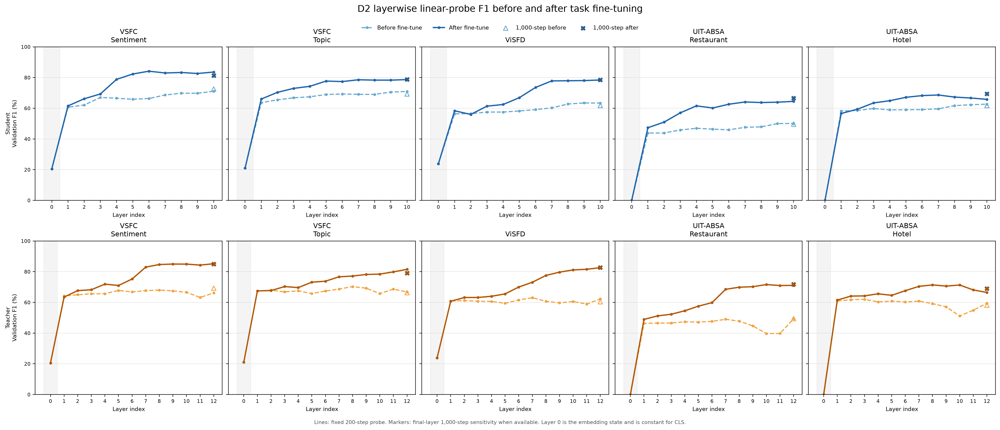
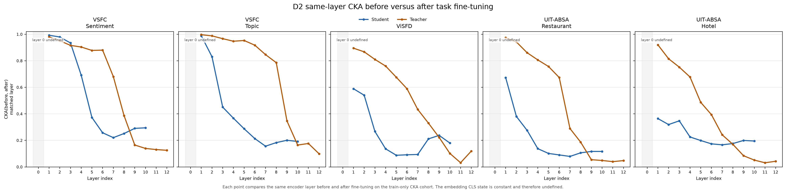

# D2 — chẩn đoán trước–sau fine-tune

## Kết luận của root

D2 khoanh vùng được một khác biệt về cách thích nghi task, nhưng chưa chứng minh một block cụ thể bị hỏng hoặc cần thay kiến trúc. Cả student và teacher đều tăng khả năng phân loại tuyến tính sau fine-tune. Teacher tăng nhiều hơn trên cả 5 task trong phép đo layer cuối với 1.000 bước, và có điểm AFTER cao hơn student trên 4/5 task (Hotel là ngoại lệ).

Không có bằng chứng về sự suy giảm thông tin task trên diện rộng của student. CKA giảm không đồng nghĩa catastrophic forgetting. Vì vậy chưa có cơ sở thay block hay đóng băng layer chỉ dựa vào độ drift.

## Phạm vi và đối chứng

BEFORE tái sử dụng D1: student GD và teacher DAPT trước task fine-tune. AFTER dùng đúng E1 CE student seed42 và teacher E2 stage0 seed42 đã chọn, mỗi task một checkpoint. Teacher là derivative BamiBERT, không phải checkpoint gốc paper.

Cùng 2.000 train rows, fullvalidation, tokenizer/masks/featureprecision BF16/SDPA, max_length256. Đủ 10 cache AFTER, strictload encoder từ checkpoint; bỏ head và optimizer. Không train encoder, mở test hoặc thêm seed. Probes 200 bước toàn layer theo đúng D1; AFTER final 1.000 bước đối chiếu BEFORE final 1.000 đã có.

## Final-layer probes cùng 1.000 bước

Đây là F1 của linearprobe trên encoder đóng băng, không phải bảng benchmark E1/E2 hoặc test. Các encoder AFTER đã học fulltrain labels và được chọn checkpoint bằng validation, nên phép đo là diagnostic có điều kiện.

| Task | Student BEFORE → AFTER | Teacher BEFORE → AFTER | AFTER Teacher − Student |
|---|---:|---:|---:|
| vsfc_sentiment | 72.58 → 81.26 | 69.27 → 85.02 | +3.76 |
| vsfc_topic | 69.29 → 78.73 | 66.32 → 79.05 | +0.31 |
| visfd | 61.79 → 78.57 | 60.39 → 82.75 | +4.19 |
| absa_restaurant | 49.68 → 66.55 | 49.44 → 71.75 | +5.20 |
| absa_hotel | 61.74 → 69.39 | 58.20 → 69.04 | -0.35 |

Teacher có mức tăng lớn hơn không tự chứng minh optimizer student sai: width, parameter count của probe, nonlinear head, lượng train labels đã dùng và checkpoint selection đều ảnh hưởng. D2 xác nhận gap gắn với giai đoạn task adaptation trong protocol này, chưa tách được nguyên nhân.

## Tín hiệu theo vùng layer

- ViSFD, probe 1.000 bước: student layer 7→10 đạt 77.50→78.57 (+1.07); teacher layer 8→12 đạt 78.24→82.75 (+4.52). Teacher tiếp tục tạo thêm khả năng phân loại ở các tầng trên tốt hơn. S7/T8 là mốc khoảng 70% độ sâu, không khẳng định hai layer tương đương chức năng.
- Restaurant: student 7→10 đạt 66.64→66.55 (gần như phẳng); teacher 8→12 đạt 70.72→71.75 (+1.03). Gap đã có trước vùng cuối, nên không quy toàn bộ vấn đề cho block cuối cùng.
- Bốn probe biên trên là follow-up post-hoc sau đường cong 200 bước, không phải full layer sweep 1.000 bước. Các điểm nhỏ và thứ hạng layer còn nhạy với budget/regularization; không gọi đây là causal bottleneck.

## CKA và đổi trọng số

Trên ABSA, biểu diễn các layer dưới của student thay đổi nhiều hơn teacher. Ví dụ same-layer CLS CKA của layer 1 trên ViSFD là 0.589 student và0.895 teacher; Restaurant 0.673/0.974; Hotel 0.364/0.920. Cả hai model đều đổi mạnh ở các tầng trên. Đây là khác biệt về phân bố thích nghi theo độ sâu, không chứng minh thay đổi ở student là có hại.

Relative L2 tổng encoder student/teacher: ViSFD 0.1176/0.0528,Restaurant 0.1159/0.0276,Hotel 0.1262/0.0538. LR student ABSA là 1e-4, teacher lần lượt 5e-5/2e-5/5e-5; epochs được chọn cũng khác. Do đó độ drift lớn hơn có confound về mức cập nhật, không thể gọi là lỗi kiến trúc.

Thống kê nhóm attention/FFN/LN đã sửa sang weight-drift-v2 bằng tái tổng hợp norm per-parameter. Không có spike chung đủ để xác định riêng attention hay FFN là thành phần cần thay. Bản cũ được giữ làm backup; arrays/probes không tính lại vì không đổi dữ liệu đầu vào.

## Bước tiếp theo đề xuất — chưa chạy

Root ưu tiên một intervention kiểm chứng **phân bố learning rate theo độ sâu**, trước khi sửa block: giữ LR các layer trên/head như E1, giảm dần LR của layer dưới/embeddings. Mục tiêu là thử giữ nền biểu diễn ổn định hơn trong khi vẫn cho các tầng trên học task. Đây là giả thuyết từ khác biệt BEFORE–AFTER, chưa phải kết luận về forgetting.

Nguyên tắc dùng learning rate khác nhau theo layer có trong [ULMFiT](https://aclanthology.org/P18-1031.pdf), nhưng paper đó không chứng minh hiệu quả trên GoiBERT; giá trị của thử nghiệm ở đây là kiểm tra dự đoán trên dữ liệu của chúng ta.

Dự đoán có thể bác bỏ: layer dưới đổi ít hơn và F1 downstream tăng. Nếu chỉ giảm drift mà F1 không tăng thì giả thuyết không giải thích được khoảng cách; dừng nhánh. Không đồng thời thêm NC/KD/MLM/block mới để giữ đối chứng rõ. Chưa có trial tiếp theo được launch trong D2.

## Kiểm tra và artifacts

10/10 cache AFTER finite/shape đúng, cohort/IDs/gold/inputhashes trùng D1;5 probe outputs,10 final sensitivity rows và4 boundary heads;5 task CKA và groupedweightdriftv2 hoàn tất. EmbeddingCLSconstant được giữ undefined trong CKA. Source D1 và checkpoints không bị sửa. Figure đã cập nhật đủ Hotel 1.000 bước.

[Plan](D2_PLAN.md), [cache](D2_CACHE.md), [measurements](D2_MEASUREMENTS.md). Artifacts đầy đủ ở artifacts/d2; hình PNG/SVG ở artifacts/d2/figures. Không có test hoặc fine-tune encoder mới.
